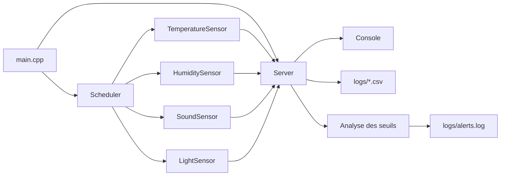
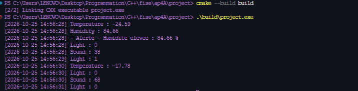
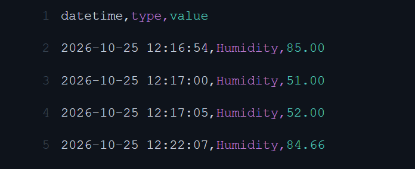
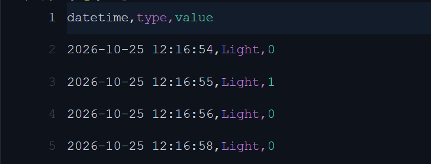
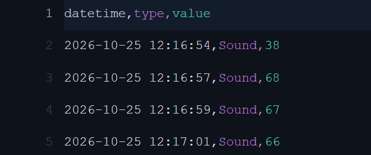
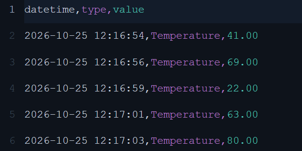
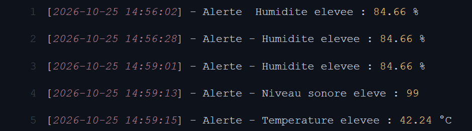

# Rapport de TP AP4A — Simulateur IoT de qualité de l'air

> **Projet C++17 — Automne 2026**
> **Sujet :** mini-projet AP4A « simulateur d'un écosystème IoT spécialisé dans le monitoring de la qualité de l'air d'un espace de travail ».

## 1. Présentation générale

Ce projet met en œuvre un simulateur d'environnement connecté. Plusieurs capteurs virtuels mesurent périodiquement des grandeurs représentatives d'un espace de travail :

- la température ;
- l'humidité ;
- le niveau sonore ;
- la luminosité.

Les mesures sont transmises à un serveur central. Le serveur les affiche dans la console, les enregistre dans des fichiers CSV et analyse certaines valeurs afin de produire des alertes. Le temps réel est simulé par un ordonnanceur (`Scheduler`) qui active chaque capteur selon son propre intervalle.

## 2. Objectifs fonctionnels

### 2.1 Fonctionnement attendu

À chaque cycle de simulation :

1. le `Scheduler` mesure le temps écoulé ;
2. il sélectionne les capteurs dont l'intervalle est arrivé à échéance ;
3. il appelle `Sensor::update()` ;
4. le polymorphisme appelle la méthode `execute()` de la classe concrète ;
5. le capteur génère une valeur aléatoire adaptée à son type ;
6. la mesure est envoyée au `Server` ;
7. le serveur l'affiche, l'enregistre et vérifie les seuils d'alerte.

### 2.2 Intervalles configurés

| Capteur             | Type de mesure | Intervalle | Valeurs générées       |
| ------------------- | -------------: | ---------: | ---------------------- |
| `TemperatureSensor` |        `float` | 2 secondes | environ -25 °C à 50 °C |
| `HumiditySensor`    |        `float` | 5 secondes | 0 % à 100 %            |
| `SoundSensor`       |          `int` | 2 secondes | 0 à 100                |
| `LightSensor`       |         `bool` |  1 seconde | 0 ou 1                 |

Le scheduler possède un pas général d'une seconde. Les intervalles spécifiques des capteurs permettent donc de simuler des fréquences de mesure différentes.

### 2.3 Règles d'alerte

Le serveur analyse les mesures reçues :

| Grandeur    |            Condition | Message produit     |
| ----------- | -------------------: | ------------------- |
| Température |            `> 30 °C` | Température élevée  |
| Humidité    |             `> 70 %` | Humidité élevée     |
| Son         |               `> 80` | Niveau sonore élevé |
| Lumière     | aucune règle définie | aucune alerte       |

Les alertes sont affichées dans la console et ajoutées à `logs/alerts.log`.

## 3. Architecture du projet

Le projet est organisé selon une séparation classique entre interface, implémentation, exécutable et données produites :

```text
project/
├── CMakeLists.txt                 # Configuration de compilation CMake
├── main.cpp                       # Point d'entrée et assemblage du système
├── include/                       # Fichiers d'en-tête
│   ├── Measurement.hpp            # Type de mesure et conversion texte
│   ├── Sensor.hpp                 # Classe abstraite de base
│   ├── TemperatureSensor.hpp
│   ├── HumiditySensor.hpp
│   ├── SoundSensor.hpp
│   ├── LightSensor.hpp
│   ├── Scheduler.hpp
│   └── Server.hpp
├── src/                           # Implémentations C++
│   ├── Sensor.cpp
│   ├── TemperatureSensor.cpp
│   ├── HumiditySensor.cpp
│   ├── SoundSensor.cpp
│   ├── LightSensor.cpp
│   ├── Scheduler.cpp
│   └── Server.cpp
├── logs/                          # Fichiers générés par l'exécution
│   ├── Temperature.csv
│   ├── Humidity.csv
│   ├── Sound.csv
│   ├── Light.csv
│   └── alerts.log
├── screenshots/                   # Captures de validation
```

### 3.1 Rôle des composants

#### `Measurement`

`Measurement` est défini comme un `std::variant<float, int, bool>`. Il permet de conserver dans une même interface les trois formes de données du sujet :

- `float` pour la température et l'humidité ;
- `int` pour le son ;
- `bool` pour la lumière.

La fonction `measurementToString()` utilise `std::visit` pour convertir proprement chaque alternative en texte. Les nombres flottants sont écrits avec deux décimales et les booléens sous forme `0` ou `1`.

#### `Sensor`

`Sensor` est la classe mère abstraite de tous les capteurs. Elle contient :

- un identifiant unique généré par l'attribut statique `nextId` ;
- le type du capteur ;
- un pointeur vers le serveur destinataire ;
- l'intervalle de mesure ;
- la dernière mesure produite.

La méthode `update()` constitue le point d'entrée appelé par l'ordonnanceur. Elle délègue la génération réelle à `execute()`, qui est virtuelle pure. `sendMeasurement()` transmet ensuite la dernière valeur au serveur.

#### Capteurs spécialisés

Chaque classe spécialisée redéfinit `execute()` :

- `TemperatureSensor` produit une température flottante ;
- `HumiditySensor` produit un taux d'humidité flottant ;
- `SoundSensor` produit un niveau sonore entier ;
- `LightSensor` produit un état booléen.

Les capteurs ne connaissent pas le détail du stockage : ils transmettent uniquement leur mesure au serveur.

#### `Scheduler`

`Scheduler` possède un tableau de pointeurs vers des `Sensor`. Sa méthode `simulate()` :

1. calcule le nombre de secondes depuis le début ;
2. compare ce temps à l'intervalle de chaque capteur ;
3. appelle `update()` lorsque l'intervalle correspond ;
4. attend le pas de simulation avec `std::this_thread::sleep_for`.

Cette approche reproduit le comportement de processus autonomes sans créer un thread par capteur.

#### `Server`

`Server` est le point central de traitement. `processMeasurement()` orchestre trois opérations :

1. `consoleWrite()` affiche la mesure ;
2. `fileWrite()` l'ajoute au fichier CSV correspondant ;
3. `analyzeMeasurement()` vérifie les seuils.

Le constructeur crée automatiquement le répertoire `logs`. Chaque CSV reçoit un en-tête :

```csv
datetime,type,value
```

Les fichiers peuvent ainsi être ouverts directement dans Excel ou un autre tableur.

## 4. Diagramme UML des classes

Le diagramme suivant décrit les principales classes, leurs relations et le polymorphisme utilisé. Il est écrit en Mermaid afin d'être rendu directement par les plateformes compatibles Markdown.

```drawio
<mxfile>
  <diagram id="Cs6-JerZkCi4v-PxVLN_" name="Page-1">
    <mxGraphModel dx="2114" dy="2707" grid="1" gridSize="10" guides="1" tooltips="0" connect="1" arrows="1" fold="1" page="1" pageScale="1" pageWidth="850" pageHeight="1100" math="0" shadow="0">
      <root>
        <mxCell id="0" />
        <mxCell id="1" parent="0" />
        <UserObject label="" mermaidData="{&#xa;  &quot;data&quot;: &quot;classDiagram\r\n    class Measurement {\r\n        &lt;&lt;variant&gt;&gt;\r\n        float\r\n        int\r\n        bool\r\n    }\r\n\r\n    class Server {\r\n        +Server()\r\n        +consoleWrite(type, value)\r\n        +fileWrite(type, value)\r\n        +processMeasurement(type, value)\r\n        +analyzeMeasurement(type, value)\r\n        -logAlert(message)\r\n    }\r\n\r\n    class Sensor {\r\n        &lt;&lt;abstract&gt;&gt;\r\n        -int id\r\n        -string type\r\n        -Server* server\r\n        -seconds interval\r\n        -static int nextId\r\n        #Measurement lastMeasurement\r\n        +update()\r\n        #execute()*\r\n        #sendMeasurement()\r\n        +getId()\r\n        +getType()\r\n        +getInterval()\r\n    }\r\n\r\n    class TemperatureSensor {\r\n        +execute()\r\n    }\r\n    class HumiditySensor {\r\n        +execute()\r\n    }\r\n    class SoundSensor {\r\n        +execute()\r\n    }\r\n    class LightSensor {\r\n        +execute()\r\n    }\r\n\r\n    class Scheduler {\r\n        -vector~Sensor*~ sensors\r\n        -seconds elapsedTime\r\n        -seconds sleepInterval\r\n        -time_point startTime\r\n        +addSensor(sensor)\r\n        +simulate()\r\n    }\r\n\r\n    Sensor &lt;|-- TemperatureSensor\r\n    Sensor &lt;|-- HumiditySensor\r\n    Sensor &lt;|-- SoundSensor\r\n    Sensor &lt;|-- LightSensor\r\n    Sensor --&gt; Server : transmet\r\n    Sensor *-- Measurement : contient\r\n    Scheduler o-- Sensor : ordonnance\r\n    Server ..&gt; Measurement : traite&quot;,&#xa;  &quot;config&quot;: null&#xa;}" id="59">
          <mxCell connectable="0" parent="1" style="group;transparentBounds=1;editIcon=1;lockedGroup=0;groupPadding=10;" vertex="1">
            <mxGeometry as="geometry" />
          </mxCell>
        </UserObject>
        <UserObject label="&lt;b&gt;Measurement&lt;/b&gt;" mermaidId="n:Measurement" mermaidBaseStyle="swimlane;html=1;fontStyle=1;fontSize=16;align=center;verticalAlign=middle;horizontal=1;childLayout=stackLayout;startSize=72;horizontalStack=0;resizeParent=1;resizeParentMax=0;resizeLast=0;collapsible=0;marginTop=12;marginBottom=12;stackSpacing=0;swimlaneFillColor=light-dark(#ECECFF,#1f2020);whiteSpace=wrap;spacingTop=24;fillColor=light-dark(#ECECFF,#1f2020);strokeColor=light-dark(#9370DB,#cccccc);fontColor=light-dark(#333333,#cccccc);fontFamily=Trebuchet MS,Verdana,Arial,sans-serif;" mermaidBaseValue="&lt;b&gt;Measurement&lt;/b&gt;" id="2">
          <mxCell parent="59" style="swimlane;html=1;fontStyle=1;fontSize=16;align=center;verticalAlign=middle;horizontal=1;childLayout=stackLayout;startSize=72;horizontalStack=0;resizeParent=1;resizeParentMax=0;resizeLast=0;collapsible=0;marginTop=12;marginBottom=12;stackSpacing=0;swimlaneFillColor=light-dark(#ECECFF,#1f2020);whiteSpace=wrap;spacingTop=24;fillColor=light-dark(#ECECFF,#1f2020);strokeColor=light-dark(#9370DB,#cccccc);fontColor=light-dark(#333333,#cccccc);fontFamily=Trebuchet MS,Verdana,Arial,sans-serif;" vertex="1">
            <mxGeometry height="192" width="120" x="464" y="1120" as="geometry" />
          </mxCell>
        </UserObject>
        <mxCell id="3" parent="2" style="text;html=1;strokeColor=none;fillColor=none;align=center;verticalAlign=middle;fontSize=16;movable=0;resizable=0;rotatable=0;points=[];fontFamily=Trebuchet MS,Verdana,Arial,sans-serif;fontColor=light-dark(#333333,#cccccc);" value="«variant»" vertex="1">
          <mxGeometry height="24" width="120" y="12" as="geometry" />
        </mxCell>
        <mxCell id="4" parent="2" style="text;fontSize=16;strokeColor=none;fillColor=none;align=left;verticalAlign=middle;spacingLeft=10;spacingRight=12;spacingBottom=2;overflow=hidden;rotatable=0;points=[[0,0.5],[1,0.5]];portConstraint=eastwest;fontFamily=Trebuchet MS,Verdana,Arial,sans-serif;fontColor=light-dark(#333333,#cccccc);" value="float" vertex="1">
          <mxGeometry height="24" width="120" y="84" as="geometry" />
        </mxCell>
        <mxCell id="5" parent="2" style="text;fontSize=16;strokeColor=none;fillColor=none;align=left;verticalAlign=middle;spacingLeft=10;spacingRight=12;spacingBottom=2;overflow=hidden;rotatable=0;points=[[0,0.5],[1,0.5]];portConstraint=eastwest;fontFamily=Trebuchet MS,Verdana,Arial,sans-serif;fontColor=light-dark(#333333,#cccccc);" value="int" vertex="1">
          <mxGeometry height="24" width="120" y="108" as="geometry" />
        </mxCell>
        <mxCell id="6" parent="2" style="text;fontSize=16;strokeColor=none;fillColor=none;align=left;verticalAlign=middle;spacingLeft=10;spacingRight=12;spacingBottom=2;overflow=hidden;rotatable=0;points=[[0,0.5],[1,0.5]];portConstraint=eastwest;fontFamily=Trebuchet MS,Verdana,Arial,sans-serif;fontColor=light-dark(#333333,#cccccc);" value="bool" vertex="1">
          <mxGeometry height="24" width="120" y="132" as="geometry" />
        </mxCell>
        <mxCell id="7" parent="2" style="line;strokeWidth=1;fillColor=none;spacingLeft=3;spacingRight=3;rotatable=0;points=[];strokeColor=inherit;" vertex="1">
          <mxGeometry height="24" width="120" y="156" as="geometry" />
        </mxCell>
        <UserObject label="&lt;b&gt;Server&lt;/b&gt;" mermaidId="n:Server" mermaidBaseStyle="swimlane;html=1;fontStyle=1;fontSize=16;align=center;verticalAlign=middle;horizontal=1;childLayout=stackLayout;startSize=48;horizontalStack=0;resizeParent=1;resizeParentMax=0;resizeLast=0;collapsible=0;marginTop=12;marginBottom=12;stackSpacing=0;swimlaneFillColor=light-dark(#ECECFF,#1f2020);whiteSpace=wrap;fillColor=light-dark(#ECECFF,#1f2020);strokeColor=light-dark(#9370DB,#cccccc);fontColor=light-dark(#333333,#cccccc);fontFamily=Trebuchet MS,Verdana,Arial,sans-serif;" mermaidBaseValue="&lt;b&gt;Server&lt;/b&gt;" id="8">
          <mxCell parent="59" style="swimlane;html=1;fontStyle=1;fontSize=16;align=center;verticalAlign=middle;horizontal=1;childLayout=stackLayout;startSize=48;horizontalStack=0;resizeParent=1;resizeParentMax=0;resizeLast=0;collapsible=0;marginTop=12;marginBottom=12;stackSpacing=0;swimlaneFillColor=light-dark(#ECECFF,#1f2020);whiteSpace=wrap;fillColor=light-dark(#ECECFF,#1f2020);strokeColor=light-dark(#9370DB,#cccccc);fontColor=light-dark(#333333,#cccccc);fontFamily=Trebuchet MS,Verdana,Arial,sans-serif;" vertex="1">
            <mxGeometry height="240" width="298" x="889" y="806" as="geometry" />
          </mxCell>
        </UserObject>
        <mxCell id="9" parent="8" style="line;strokeWidth=1;fillColor=none;spacingLeft=3;spacingRight=3;rotatable=0;points=[];strokeColor=inherit;" vertex="1">
          <mxGeometry height="24" width="298" y="60" as="geometry" />
        </mxCell>
        <mxCell id="10" parent="8" style="text;fontSize=16;strokeColor=none;fillColor=none;align=left;verticalAlign=middle;spacingLeft=10;spacingRight=12;spacingBottom=2;overflow=hidden;rotatable=0;points=[[0,0.5],[1,0.5]];portConstraint=eastwest;fontFamily=Trebuchet MS,Verdana,Arial,sans-serif;fontColor=light-dark(#333333,#cccccc);" value="+Server()" vertex="1">
          <mxGeometry height="24" width="298" y="84" as="geometry" />
        </mxCell>
        <mxCell id="11" parent="8" style="text;fontSize=16;strokeColor=none;fillColor=none;align=left;verticalAlign=middle;spacingLeft=10;spacingRight=12;spacingBottom=2;overflow=hidden;rotatable=0;points=[[0,0.5],[1,0.5]];portConstraint=eastwest;fontFamily=Trebuchet MS,Verdana,Arial,sans-serif;fontColor=light-dark(#333333,#cccccc);" value="+consoleWrite(type, value)" vertex="1">
          <mxGeometry height="24" width="298" y="108" as="geometry" />
        </mxCell>
        <mxCell id="12" parent="8" style="text;fontSize=16;strokeColor=none;fillColor=none;align=left;verticalAlign=middle;spacingLeft=10;spacingRight=12;spacingBottom=2;overflow=hidden;rotatable=0;points=[[0,0.5],[1,0.5]];portConstraint=eastwest;fontFamily=Trebuchet MS,Verdana,Arial,sans-serif;fontColor=light-dark(#333333,#cccccc);" value="+fileWrite(type, value)" vertex="1">
          <mxGeometry height="24" width="298" y="132" as="geometry" />
        </mxCell>
        <mxCell id="13" parent="8" style="text;fontSize=16;strokeColor=none;fillColor=none;align=left;verticalAlign=middle;spacingLeft=10;spacingRight=12;spacingBottom=2;overflow=hidden;rotatable=0;points=[[0,0.5],[1,0.5]];portConstraint=eastwest;fontFamily=Trebuchet MS,Verdana,Arial,sans-serif;fontColor=light-dark(#333333,#cccccc);" value="+processMeasurement(type, value)" vertex="1">
          <mxGeometry height="24" width="298" y="156" as="geometry" />
        </mxCell>
        <mxCell id="14" parent="8" style="text;fontSize=16;strokeColor=none;fillColor=none;align=left;verticalAlign=middle;spacingLeft=10;spacingRight=12;spacingBottom=2;overflow=hidden;rotatable=0;points=[[0,0.5],[1,0.5]];portConstraint=eastwest;fontFamily=Trebuchet MS,Verdana,Arial,sans-serif;fontColor=light-dark(#333333,#cccccc);" value="+analyzeMeasurement(type, value)" vertex="1">
          <mxGeometry height="24" width="298" y="180" as="geometry" />
        </mxCell>
        <mxCell id="15" parent="8" style="text;fontSize=16;strokeColor=none;fillColor=none;align=left;verticalAlign=middle;spacingLeft=10;spacingRight=12;spacingBottom=2;overflow=hidden;rotatable=0;points=[[0,0.5],[1,0.5]];portConstraint=eastwest;fontFamily=Trebuchet MS,Verdana,Arial,sans-serif;fontColor=light-dark(#333333,#cccccc);" value="-logAlert(message)" vertex="1">
          <mxGeometry height="24" width="298" y="204" as="geometry" />
        </mxCell>
        <UserObject label="&lt;b&gt;Sensor&lt;/b&gt;" mermaidId="n:Sensor" mermaidBaseStyle="swimlane;html=1;fontStyle=1;fontSize=16;align=center;verticalAlign=middle;horizontal=1;childLayout=stackLayout;startSize=72;horizontalStack=0;resizeParent=1;resizeParentMax=0;resizeLast=0;collapsible=0;marginTop=12;marginBottom=12;stackSpacing=0;swimlaneFillColor=light-dark(#ECECFF,#1f2020);whiteSpace=wrap;spacingTop=24;fillColor=light-dark(#ECECFF,#1f2020);strokeColor=light-dark(#9370DB,#cccccc);fontColor=light-dark(#333333,#cccccc);fontFamily=Trebuchet MS,Verdana,Arial,sans-serif;" mermaidBaseValue="&lt;b&gt;Sensor&lt;/b&gt;" id="16">
          <mxCell parent="59" style="swimlane;html=1;fontStyle=1;fontSize=16;align=center;verticalAlign=middle;horizontal=1;childLayout=stackLayout;startSize=72;horizontalStack=0;resizeParent=1;resizeParentMax=0;resizeLast=0;collapsible=0;marginTop=12;marginBottom=12;stackSpacing=0;swimlaneFillColor=light-dark(#ECECFF,#1f2020);whiteSpace=wrap;spacingTop=24;fillColor=light-dark(#ECECFF,#1f2020);strokeColor=light-dark(#9370DB,#cccccc);fontColor=light-dark(#333333,#cccccc);fontFamily=Trebuchet MS,Verdana,Arial,sans-serif;" vertex="1">
            <mxGeometry height="408" width="293" x="327" y="324" as="geometry" />
          </mxCell>
        </UserObject>
        <mxCell id="17" parent="16" style="text;html=1;strokeColor=none;fillColor=none;align=center;verticalAlign=middle;fontSize=16;movable=0;resizable=0;rotatable=0;points=[];fontFamily=Trebuchet MS,Verdana,Arial,sans-serif;fontColor=light-dark(#333333,#cccccc);" value="«abstract»" vertex="1">
          <mxGeometry height="24" width="293" y="12" as="geometry" />
        </mxCell>
        <mxCell id="18" parent="16" style="text;fontSize=16;strokeColor=none;fillColor=none;align=left;verticalAlign=middle;spacingLeft=10;spacingRight=12;spacingBottom=2;overflow=hidden;rotatable=0;points=[[0,0.5],[1,0.5]];portConstraint=eastwest;fontFamily=Trebuchet MS,Verdana,Arial,sans-serif;fontColor=light-dark(#333333,#cccccc);" value="-int id" vertex="1">
          <mxGeometry height="24" width="293" y="84" as="geometry" />
        </mxCell>
        <mxCell id="19" parent="16" style="text;fontSize=16;strokeColor=none;fillColor=none;align=left;verticalAlign=middle;spacingLeft=10;spacingRight=12;spacingBottom=2;overflow=hidden;rotatable=0;points=[[0,0.5],[1,0.5]];portConstraint=eastwest;fontFamily=Trebuchet MS,Verdana,Arial,sans-serif;fontColor=light-dark(#333333,#cccccc);" value="-string type" vertex="1">
          <mxGeometry height="24" width="293" y="108" as="geometry" />
        </mxCell>
        <mxCell id="20" parent="16" style="text;fontSize=16;strokeColor=none;fillColor=none;align=left;verticalAlign=middle;spacingLeft=10;spacingRight=12;spacingBottom=2;overflow=hidden;rotatable=0;points=[[0,0.5],[1,0.5]];portConstraint=eastwest;fontFamily=Trebuchet MS,Verdana,Arial,sans-serif;fontColor=light-dark(#333333,#cccccc);" value="-Server* server" vertex="1">
          <mxGeometry height="24" width="293" y="132" as="geometry" />
        </mxCell>
        <mxCell id="21" parent="16" style="text;fontSize=16;strokeColor=none;fillColor=none;align=left;verticalAlign=middle;spacingLeft=10;spacingRight=12;spacingBottom=2;overflow=hidden;rotatable=0;points=[[0,0.5],[1,0.5]];portConstraint=eastwest;fontFamily=Trebuchet MS,Verdana,Arial,sans-serif;fontColor=light-dark(#333333,#cccccc);" value="-seconds interval" vertex="1">
          <mxGeometry height="24" width="293" y="156" as="geometry" />
        </mxCell>
        <mxCell id="22" parent="16" style="text;fontSize=16;strokeColor=none;fillColor=none;align=left;verticalAlign=middle;spacingLeft=10;spacingRight=12;spacingBottom=2;overflow=hidden;rotatable=0;points=[[0,0.5],[1,0.5]];portConstraint=eastwest;fontFamily=Trebuchet MS,Verdana,Arial,sans-serif;fontColor=light-dark(#333333,#cccccc);" value="-static int nextId" vertex="1">
          <mxGeometry height="24" width="293" y="180" as="geometry" />
        </mxCell>
        <mxCell id="23" parent="16" style="text;fontSize=16;strokeColor=none;fillColor=none;align=left;verticalAlign=middle;spacingLeft=10;spacingRight=12;spacingBottom=2;overflow=hidden;rotatable=0;points=[[0,0.5],[1,0.5]];portConstraint=eastwest;fontFamily=Trebuchet MS,Verdana,Arial,sans-serif;fontColor=light-dark(#333333,#cccccc);" value="#Measurement lastMeasurement" vertex="1">
          <mxGeometry height="24" width="293" y="204" as="geometry" />
        </mxCell>
        <mxCell id="24" parent="16" style="line;strokeWidth=1;fillColor=none;spacingLeft=3;spacingRight=3;rotatable=0;points=[];strokeColor=inherit;" vertex="1">
          <mxGeometry height="24" width="293" y="228" as="geometry" />
        </mxCell>
        <mxCell id="25" parent="16" style="text;fontSize=16;strokeColor=none;fillColor=none;align=left;verticalAlign=middle;spacingLeft=10;spacingRight=12;spacingBottom=2;overflow=hidden;rotatable=0;points=[[0,0.5],[1,0.5]];portConstraint=eastwest;fontFamily=Trebuchet MS,Verdana,Arial,sans-serif;fontColor=light-dark(#333333,#cccccc);" value="+update()" vertex="1">
          <mxGeometry height="24" width="293" y="252" as="geometry" />
        </mxCell>
        <mxCell id="26" parent="16" style="text;fontSize=16;strokeColor=none;fillColor=none;align=left;verticalAlign=middle;spacingLeft=10;spacingRight=12;spacingBottom=2;overflow=hidden;rotatable=0;points=[[0,0.5],[1,0.5]];portConstraint=eastwest;fontFamily=Trebuchet MS,Verdana,Arial,sans-serif;fontColor=light-dark(#333333,#cccccc);fontStyle=2;" value="#execute()" vertex="1">
          <mxGeometry height="24" width="293" y="276" as="geometry" />
        </mxCell>
        <mxCell id="27" parent="16" style="text;fontSize=16;strokeColor=none;fillColor=none;align=left;verticalAlign=middle;spacingLeft=10;spacingRight=12;spacingBottom=2;overflow=hidden;rotatable=0;points=[[0,0.5],[1,0.5]];portConstraint=eastwest;fontFamily=Trebuchet MS,Verdana,Arial,sans-serif;fontColor=light-dark(#333333,#cccccc);" value="#sendMeasurement()" vertex="1">
          <mxGeometry height="24" width="293" y="300" as="geometry" />
        </mxCell>
        <mxCell id="28" parent="16" style="text;fontSize=16;strokeColor=none;fillColor=none;align=left;verticalAlign=middle;spacingLeft=10;spacingRight=12;spacingBottom=2;overflow=hidden;rotatable=0;points=[[0,0.5],[1,0.5]];portConstraint=eastwest;fontFamily=Trebuchet MS,Verdana,Arial,sans-serif;fontColor=light-dark(#333333,#cccccc);" value="+getId()" vertex="1">
          <mxGeometry height="24" width="293" y="324" as="geometry" />
        </mxCell>
        <mxCell id="29" parent="16" style="text;fontSize=16;strokeColor=none;fillColor=none;align=left;verticalAlign=middle;spacingLeft=10;spacingRight=12;spacingBottom=2;overflow=hidden;rotatable=0;points=[[0,0.5],[1,0.5]];portConstraint=eastwest;fontFamily=Trebuchet MS,Verdana,Arial,sans-serif;fontColor=light-dark(#333333,#cccccc);" value="+getType()" vertex="1">
          <mxGeometry height="24" width="293" y="348" as="geometry" />
        </mxCell>
        <mxCell id="30" parent="16" style="text;fontSize=16;strokeColor=none;fillColor=none;align=left;verticalAlign=middle;spacingLeft=10;spacingRight=12;spacingBottom=2;overflow=hidden;rotatable=0;points=[[0,0.5],[1,0.5]];portConstraint=eastwest;fontFamily=Trebuchet MS,Verdana,Arial,sans-serif;fontColor=light-dark(#333333,#cccccc);" value="+getInterval()" vertex="1">
          <mxGeometry height="24" width="293" y="372" as="geometry" />
        </mxCell>
        <UserObject label="&lt;b&gt;TemperatureSensor&lt;/b&gt;" mermaidId="n:TemperatureSensor" mermaidBaseStyle="swimlane;html=1;fontStyle=1;fontSize=16;align=center;verticalAlign=middle;horizontal=1;childLayout=stackLayout;startSize=48;horizontalStack=0;resizeParent=1;resizeParentMax=0;resizeLast=0;collapsible=0;marginTop=12;marginBottom=12;stackSpacing=0;swimlaneFillColor=light-dark(#ECECFF,#1f2020);whiteSpace=wrap;fillColor=light-dark(#ECECFF,#1f2020);strokeColor=light-dark(#9370DB,#cccccc);fontColor=light-dark(#333333,#cccccc);fontFamily=Trebuchet MS,Verdana,Arial,sans-serif;" mermaidBaseValue="&lt;b&gt;TemperatureSensor&lt;/b&gt;" id="31">
          <mxCell parent="59" style="swimlane;html=1;fontStyle=1;fontSize=16;align=center;verticalAlign=middle;horizontal=1;childLayout=stackLayout;startSize=48;horizontalStack=0;resizeParent=1;resizeParentMax=0;resizeLast=0;collapsible=0;marginTop=12;marginBottom=12;stackSpacing=0;swimlaneFillColor=light-dark(#ECECFF,#1f2020);whiteSpace=wrap;fillColor=light-dark(#ECECFF,#1f2020);strokeColor=light-dark(#9370DB,#cccccc);fontColor=light-dark(#333333,#cccccc);fontFamily=Trebuchet MS,Verdana,Arial,sans-serif;" vertex="1">
            <mxGeometry height="120" width="170" x="75" y="866" as="geometry" />
          </mxCell>
        </UserObject>
        <mxCell id="32" parent="31" style="line;strokeWidth=1;fillColor=none;spacingLeft=3;spacingRight=3;rotatable=0;points=[];strokeColor=inherit;" vertex="1">
          <mxGeometry height="24" width="170" y="60" as="geometry" />
        </mxCell>
        <mxCell id="33" parent="31" style="text;fontSize=16;strokeColor=none;fillColor=none;align=left;verticalAlign=middle;spacingLeft=10;spacingRight=12;spacingBottom=2;overflow=hidden;rotatable=0;points=[[0,0.5],[1,0.5]];portConstraint=eastwest;fontFamily=Trebuchet MS,Verdana,Arial,sans-serif;fontColor=light-dark(#333333,#cccccc);" value="+execute()" vertex="1">
          <mxGeometry height="24" width="170" y="84" as="geometry" />
        </mxCell>
        <UserObject label="&lt;b&gt;HumiditySensor&lt;/b&gt;" mermaidId="n:HumiditySensor" mermaidBaseStyle="swimlane;html=1;fontStyle=1;fontSize=16;align=center;verticalAlign=middle;horizontal=1;childLayout=stackLayout;startSize=48;horizontalStack=0;resizeParent=1;resizeParentMax=0;resizeLast=0;collapsible=0;marginTop=12;marginBottom=12;stackSpacing=0;swimlaneFillColor=light-dark(#ECECFF,#1f2020);whiteSpace=wrap;fillColor=light-dark(#ECECFF,#1f2020);strokeColor=light-dark(#9370DB,#cccccc);fontColor=light-dark(#333333,#cccccc);fontFamily=Trebuchet MS,Verdana,Arial,sans-serif;" mermaidBaseValue="&lt;b&gt;HumiditySensor&lt;/b&gt;" id="34">
          <mxCell parent="59" style="swimlane;html=1;fontStyle=1;fontSize=16;align=center;verticalAlign=middle;horizontal=1;childLayout=stackLayout;startSize=48;horizontalStack=0;resizeParent=1;resizeParentMax=0;resizeLast=0;collapsible=0;marginTop=12;marginBottom=12;stackSpacing=0;swimlaneFillColor=light-dark(#ECECFF,#1f2020);whiteSpace=wrap;fillColor=light-dark(#ECECFF,#1f2020);strokeColor=light-dark(#9370DB,#cccccc);fontColor=light-dark(#333333,#cccccc);fontFamily=Trebuchet MS,Verdana,Arial,sans-serif;" vertex="1">
            <mxGeometry height="120" width="157" x="295" y="866" as="geometry" />
          </mxCell>
        </UserObject>
        <mxCell id="35" parent="34" style="line;strokeWidth=1;fillColor=none;spacingLeft=3;spacingRight=3;rotatable=0;points=[];strokeColor=inherit;" vertex="1">
          <mxGeometry height="24" width="157" y="60" as="geometry" />
        </mxCell>
        <mxCell id="36" parent="34" style="text;fontSize=16;strokeColor=none;fillColor=none;align=left;verticalAlign=middle;spacingLeft=10;spacingRight=12;spacingBottom=2;overflow=hidden;rotatable=0;points=[[0,0.5],[1,0.5]];portConstraint=eastwest;fontFamily=Trebuchet MS,Verdana,Arial,sans-serif;fontColor=light-dark(#333333,#cccccc);" value="+execute()" vertex="1">
          <mxGeometry height="24" width="157" y="84" as="geometry" />
        </mxCell>
        <UserObject label="&lt;b&gt;SoundSensor&lt;/b&gt;" mermaidId="n:SoundSensor" mermaidBaseStyle="swimlane;html=1;fontStyle=1;fontSize=16;align=center;verticalAlign=middle;horizontal=1;childLayout=stackLayout;startSize=48;horizontalStack=0;resizeParent=1;resizeParentMax=0;resizeLast=0;collapsible=0;marginTop=12;marginBottom=12;stackSpacing=0;swimlaneFillColor=light-dark(#ECECFF,#1f2020);whiteSpace=wrap;fillColor=light-dark(#ECECFF,#1f2020);strokeColor=light-dark(#9370DB,#cccccc);fontColor=light-dark(#333333,#cccccc);fontFamily=Trebuchet MS,Verdana,Arial,sans-serif;" mermaidBaseValue="&lt;b&gt;SoundSensor&lt;/b&gt;" id="37">
          <mxCell parent="59" style="swimlane;html=1;fontStyle=1;fontSize=16;align=center;verticalAlign=middle;horizontal=1;childLayout=stackLayout;startSize=48;horizontalStack=0;resizeParent=1;resizeParentMax=0;resizeLast=0;collapsible=0;marginTop=12;marginBottom=12;stackSpacing=0;swimlaneFillColor=light-dark(#ECECFF,#1f2020);whiteSpace=wrap;fillColor=light-dark(#ECECFF,#1f2020);strokeColor=light-dark(#9370DB,#cccccc);fontColor=light-dark(#333333,#cccccc);fontFamily=Trebuchet MS,Verdana,Arial,sans-serif;" vertex="1">
            <mxGeometry height="120" width="146" x="502" y="866" as="geometry" />
          </mxCell>
        </UserObject>
        <mxCell id="38" parent="37" style="line;strokeWidth=1;fillColor=none;spacingLeft=3;spacingRight=3;rotatable=0;points=[];strokeColor=inherit;" vertex="1">
          <mxGeometry height="24" width="146" y="60" as="geometry" />
        </mxCell>
        <mxCell id="39" parent="37" style="text;fontSize=16;strokeColor=none;fillColor=none;align=left;verticalAlign=middle;spacingLeft=10;spacingRight=12;spacingBottom=2;overflow=hidden;rotatable=0;points=[[0,0.5],[1,0.5]];portConstraint=eastwest;fontFamily=Trebuchet MS,Verdana,Arial,sans-serif;fontColor=light-dark(#333333,#cccccc);" value="+execute()" vertex="1">
          <mxGeometry height="24" width="146" y="84" as="geometry" />
        </mxCell>
        <UserObject label="&lt;b&gt;LightSensor&lt;/b&gt;" mermaidId="n:LightSensor" mermaidBaseStyle="swimlane;html=1;fontStyle=1;fontSize=16;align=center;verticalAlign=middle;horizontal=1;childLayout=stackLayout;startSize=48;horizontalStack=0;resizeParent=1;resizeParentMax=0;resizeLast=0;collapsible=0;marginTop=12;marginBottom=12;stackSpacing=0;swimlaneFillColor=light-dark(#ECECFF,#1f2020);whiteSpace=wrap;fillColor=light-dark(#ECECFF,#1f2020);strokeColor=light-dark(#9370DB,#cccccc);fontColor=light-dark(#333333,#cccccc);fontFamily=Trebuchet MS,Verdana,Arial,sans-serif;" mermaidBaseValue="&lt;b&gt;LightSensor&lt;/b&gt;" id="40">
          <mxCell parent="59" style="swimlane;html=1;fontStyle=1;fontSize=16;align=center;verticalAlign=middle;horizontal=1;childLayout=stackLayout;startSize=48;horizontalStack=0;resizeParent=1;resizeParentMax=0;resizeLast=0;collapsible=0;marginTop=12;marginBottom=12;stackSpacing=0;swimlaneFillColor=light-dark(#ECECFF,#1f2020);whiteSpace=wrap;fillColor=light-dark(#ECECFF,#1f2020);strokeColor=light-dark(#9370DB,#cccccc);fontColor=light-dark(#333333,#cccccc);fontFamily=Trebuchet MS,Verdana,Arial,sans-serif;" vertex="1">
            <mxGeometry height="120" width="142" x="697" y="866" as="geometry" />
          </mxCell>
        </UserObject>
        <mxCell id="41" parent="40" style="line;strokeWidth=1;fillColor=none;spacingLeft=3;spacingRight=3;rotatable=0;points=[];strokeColor=inherit;" vertex="1">
          <mxGeometry height="24" width="142" y="60" as="geometry" />
        </mxCell>
        <mxCell id="42" parent="40" style="text;fontSize=16;strokeColor=none;fillColor=none;align=left;verticalAlign=middle;spacingLeft=10;spacingRight=12;spacingBottom=2;overflow=hidden;rotatable=0;points=[[0,0.5],[1,0.5]];portConstraint=eastwest;fontFamily=Trebuchet MS,Verdana,Arial,sans-serif;fontColor=light-dark(#333333,#cccccc);" value="+execute()" vertex="1">
          <mxGeometry height="24" width="142" y="84" as="geometry" />
        </mxCell>
        <UserObject label="&lt;b&gt;Scheduler&lt;/b&gt;" mermaidId="n:Scheduler" mermaidBaseStyle="swimlane;html=1;fontStyle=1;fontSize=16;align=center;verticalAlign=middle;horizontal=1;childLayout=stackLayout;startSize=48;horizontalStack=0;resizeParent=1;resizeParentMax=0;resizeLast=0;collapsible=0;marginTop=12;marginBottom=12;stackSpacing=0;swimlaneFillColor=light-dark(#ECECFF,#1f2020);whiteSpace=wrap;fillColor=light-dark(#ECECFF,#1f2020);strokeColor=light-dark(#9370DB,#cccccc);fontColor=light-dark(#333333,#cccccc);fontFamily=Trebuchet MS,Verdana,Arial,sans-serif;" mermaidBaseValue="&lt;b&gt;Scheduler&lt;/b&gt;" id="43">
          <mxCell parent="59" style="swimlane;html=1;fontStyle=1;fontSize=16;align=center;verticalAlign=middle;horizontal=1;childLayout=stackLayout;startSize=48;horizontalStack=0;resizeParent=1;resizeParentMax=0;resizeLast=0;collapsible=0;marginTop=12;marginBottom=12;stackSpacing=0;swimlaneFillColor=light-dark(#ECECFF,#1f2020);whiteSpace=wrap;fillColor=light-dark(#ECECFF,#1f2020);strokeColor=light-dark(#9370DB,#cccccc);fontColor=light-dark(#333333,#cccccc);fontFamily=Trebuchet MS,Verdana,Arial,sans-serif;" vertex="1">
            <mxGeometry height="240" width="236" x="356" y="10" as="geometry" />
          </mxCell>
        </UserObject>
        <mxCell id="44" parent="43" style="text;fontSize=16;strokeColor=none;fillColor=none;align=left;verticalAlign=middle;spacingLeft=10;spacingRight=12;spacingBottom=2;overflow=hidden;rotatable=0;points=[[0,0.5],[1,0.5]];portConstraint=eastwest;fontFamily=Trebuchet MS,Verdana,Arial,sans-serif;fontColor=light-dark(#333333,#cccccc);" value="-vector&lt;Sensor*&gt; sensors" vertex="1">
          <mxGeometry height="24" width="236" y="60" as="geometry" />
        </mxCell>
        <mxCell id="45" parent="43" style="text;fontSize=16;strokeColor=none;fillColor=none;align=left;verticalAlign=middle;spacingLeft=10;spacingRight=12;spacingBottom=2;overflow=hidden;rotatable=0;points=[[0,0.5],[1,0.5]];portConstraint=eastwest;fontFamily=Trebuchet MS,Verdana,Arial,sans-serif;fontColor=light-dark(#333333,#cccccc);" value="-seconds elapsedTime" vertex="1">
          <mxGeometry height="24" width="236" y="84" as="geometry" />
        </mxCell>
        <mxCell id="46" parent="43" style="text;fontSize=16;strokeColor=none;fillColor=none;align=left;verticalAlign=middle;spacingLeft=10;spacingRight=12;spacingBottom=2;overflow=hidden;rotatable=0;points=[[0,0.5],[1,0.5]];portConstraint=eastwest;fontFamily=Trebuchet MS,Verdana,Arial,sans-serif;fontColor=light-dark(#333333,#cccccc);" value="-seconds sleepInterval" vertex="1">
          <mxGeometry height="24" width="236" y="108" as="geometry" />
        </mxCell>
        <mxCell id="47" parent="43" style="text;fontSize=16;strokeColor=none;fillColor=none;align=left;verticalAlign=middle;spacingLeft=10;spacingRight=12;spacingBottom=2;overflow=hidden;rotatable=0;points=[[0,0.5],[1,0.5]];portConstraint=eastwest;fontFamily=Trebuchet MS,Verdana,Arial,sans-serif;fontColor=light-dark(#333333,#cccccc);" value="-time_point startTime" vertex="1">
          <mxGeometry height="24" width="236" y="132" as="geometry" />
        </mxCell>
        <mxCell id="48" parent="43" style="line;strokeWidth=1;fillColor=none;spacingLeft=3;spacingRight=3;rotatable=0;points=[];strokeColor=inherit;" vertex="1">
          <mxGeometry height="24" width="236" y="156" as="geometry" />
        </mxCell>
        <mxCell id="49" parent="43" style="text;fontSize=16;strokeColor=none;fillColor=none;align=left;verticalAlign=middle;spacingLeft=10;spacingRight=12;spacingBottom=2;overflow=hidden;rotatable=0;points=[[0,0.5],[1,0.5]];portConstraint=eastwest;fontFamily=Trebuchet MS,Verdana,Arial,sans-serif;fontColor=light-dark(#333333,#cccccc);" value="+addSensor(sensor)" vertex="1">
          <mxGeometry height="24" width="236" y="180" as="geometry" />
        </mxCell>
        <mxCell id="50" parent="43" style="text;fontSize=16;strokeColor=none;fillColor=none;align=left;verticalAlign=middle;spacingLeft=10;spacingRight=12;spacingBottom=2;overflow=hidden;rotatable=0;points=[[0,0.5],[1,0.5]];portConstraint=eastwest;fontFamily=Trebuchet MS,Verdana,Arial,sans-serif;fontColor=light-dark(#333333,#cccccc);" value="+simulate()" vertex="1">
          <mxGeometry height="24" width="236" y="204" as="geometry" />
        </mxCell>
        <UserObject label="" mermaidId="e:Sensor-&gt;TemperatureSensor#0" mermaidBaseStyle="curved=1;startArrow=mermaidExtension;startSize=17;startFill=0;endArrow=none;strokeColor=light-dark(#333333,#cccccc);exitX=0;exitY=0.78;entryX=0.5;entryY=0;" mermaidBaseValue="" id="51">
          <mxCell edge="1" parent="59" source="16" style="curved=1;startArrow=mermaidExtension;startSize=17;startFill=0;endArrow=none;strokeColor=light-dark(#333333,#cccccc);exitX=0;exitY=0.78;entryX=0.5;entryY=0;" target="31">
            <mxGeometry relative="1" as="geometry">
              <Array as="points">
                <mxPoint x="160" y="769" />
              </Array>
            </mxGeometry>
          </mxCell>
        </UserObject>
        <UserObject label="" mermaidId="e:Sensor-&gt;HumiditySensor#0" mermaidBaseStyle="curved=1;startArrow=mermaidExtension;startSize=17;startFill=0;endArrow=none;strokeColor=light-dark(#333333,#cccccc);exitX=0.21;exitY=1;entryX=0.5;entryY=0;" mermaidBaseValue="" id="52">
          <mxCell edge="1" parent="59" source="16" style="curved=1;startArrow=mermaidExtension;startSize=17;startFill=0;endArrow=none;strokeColor=light-dark(#333333,#cccccc);exitX=0.21;exitY=1;entryX=0.5;entryY=0;" target="34">
            <mxGeometry relative="1" as="geometry">
              <Array as="points">
                <mxPoint x="373" y="769" />
              </Array>
            </mxGeometry>
          </mxCell>
        </UserObject>
        <UserObject label="" mermaidId="e:Sensor-&gt;SoundSensor#0" mermaidBaseStyle="curved=1;startArrow=mermaidExtension;startSize=17;startFill=0;endArrow=none;strokeColor=light-dark(#333333,#cccccc);exitX=0.79;exitY=1;entryX=0.49;entryY=0;" mermaidBaseValue="" id="53">
          <mxCell edge="1" parent="59" source="16" style="curved=1;startArrow=mermaidExtension;startSize=17;startFill=0;endArrow=none;strokeColor=light-dark(#333333,#cccccc);exitX=0.79;exitY=1;entryX=0.49;entryY=0;" target="37">
            <mxGeometry relative="1" as="geometry">
              <Array as="points">
                <mxPoint x="574" y="769" />
              </Array>
            </mxGeometry>
          </mxCell>
        </UserObject>
        <UserObject label="" mermaidId="e:Sensor-&gt;LightSensor#0" mermaidBaseStyle="curved=1;startArrow=mermaidExtension;startSize=17;startFill=0;endArrow=none;strokeColor=light-dark(#333333,#cccccc);exitX=1;exitY=0.79;entryX=0.5;entryY=0;" mermaidBaseValue="" id="54">
          <mxCell edge="1" parent="59" source="16" style="curved=1;startArrow=mermaidExtension;startSize=17;startFill=0;endArrow=none;strokeColor=light-dark(#333333,#cccccc);exitX=1;exitY=0.79;entryX=0.5;entryY=0;" target="40">
            <mxGeometry relative="1" as="geometry">
              <Array as="points">
                <mxPoint x="768" y="769" />
              </Array>
            </mxGeometry>
          </mxCell>
        </UserObject>
        <UserObject label="transmet" mermaidId="e:Sensor-&gt;Server#0" mermaidBaseStyle="curved=1;startArrow=none;endArrow=classic;endSize=9;strokeColor=light-dark(#333333,#cccccc);html=1;fontSize=16;labelBackgroundColor=light-dark(#ECECFF,#1f2020);fontFamily=Trebuchet MS,Verdana,Arial,sans-serif;fontColor=light-dark(#333333,#cccccc);exitX=1;exitY=0.65;entryX=0.5;entryY=0;" mermaidBaseValue="transmet" id="55">
          <mxCell edge="1" parent="59" source="16" style="curved=1;startArrow=none;endArrow=classic;endSize=9;strokeColor=light-dark(#333333,#cccccc);html=1;fontSize=16;labelBackgroundColor=light-dark(#ECECFF,#1f2020);fontFamily=Trebuchet MS,Verdana,Arial,sans-serif;fontColor=light-dark(#333333,#cccccc);exitX=1;exitY=0.65;entryX=0.5;entryY=0;" target="8">
            <mxGeometry relative="1" as="geometry">
              <Array as="points">
                <mxPoint x="1038" y="769" />
              </Array>
            </mxGeometry>
          </mxCell>
        </UserObject>
        <UserObject label="contient" mermaidId="e:Sensor-&gt;Measurement#0" mermaidBaseStyle="curved=1;startArrow=mermaidDiamond;startSize=17;startFill=1;endArrow=none;strokeColor=light-dark(#333333,#cccccc);html=1;fontSize=16;labelBackgroundColor=light-dark(#ECECFF,#1f2020);fontFamily=Trebuchet MS,Verdana,Arial,sans-serif;fontColor=light-dark(#333333,#cccccc);exitX=0;exitY=0.69;entryX=0;entryY=0.42;" mermaidBaseValue="contient" id="56">
          <mxCell edge="1" parent="59" source="16" style="curved=1;startArrow=mermaidDiamond;startSize=17;startFill=1;endArrow=none;strokeColor=light-dark(#333333,#cccccc);html=1;fontSize=16;labelBackgroundColor=light-dark(#ECECFF,#1f2020);fontFamily=Trebuchet MS,Verdana,Arial,sans-serif;fontColor=light-dark(#333333,#cccccc);exitX=0;exitY=0.69;entryX=0;entryY=0.42;" target="2">
            <mxGeometry relative="1" as="geometry">
              <Array as="points">
                <mxPoint x="10" y="769" />
                <mxPoint x="10" y="926" />
                <mxPoint x="10" y="1083" />
              </Array>
            </mxGeometry>
          </mxCell>
        </UserObject>
        <UserObject label="ordonnance" mermaidId="e:Scheduler-&gt;Sensor#0" mermaidBaseStyle="curved=1;startArrow=mermaidDiamond;startSize=17;startFill=0;endArrow=none;strokeColor=light-dark(#333333,#cccccc);html=1;fontSize=16;labelBackgroundColor=light-dark(#ECECFF,#1f2020);fontFamily=Trebuchet MS,Verdana,Arial,sans-serif;fontColor=light-dark(#333333,#cccccc);exitX=0.5;exitY=1;entryX=0.5;entryY=0;" mermaidBaseValue="ordonnance" id="57">
          <mxCell edge="1" parent="59" source="43" style="curved=1;startArrow=mermaidDiamond;startSize=17;startFill=0;endArrow=none;strokeColor=light-dark(#333333,#cccccc);html=1;fontSize=16;labelBackgroundColor=light-dark(#ECECFF,#1f2020);fontFamily=Trebuchet MS,Verdana,Arial,sans-serif;fontColor=light-dark(#333333,#cccccc);exitX=0.5;exitY=1;entryX=0.5;entryY=0;" target="16">
            <mxGeometry relative="1" as="geometry">
              <Array as="points" />
            </mxGeometry>
          </mxCell>
        </UserObject>
        <UserObject label="traite" mermaidId="e:Server-&gt;Measurement#0" mermaidBaseStyle="curved=1;dashed=1;startArrow=none;endArrow=classic;endSize=9;strokeColor=light-dark(#333333,#cccccc);html=1;fontSize=16;labelBackgroundColor=light-dark(#ECECFF,#1f2020);fontFamily=Trebuchet MS,Verdana,Arial,sans-serif;fontColor=light-dark(#333333,#cccccc);exitX=0.5;exitY=1;entryX=1;entryY=0.42;" mermaidBaseValue="traite" id="58">
          <mxCell edge="1" parent="59" source="8" style="curved=1;dashed=1;startArrow=none;endArrow=classic;endSize=9;strokeColor=light-dark(#333333,#cccccc);html=1;fontSize=16;labelBackgroundColor=light-dark(#ECECFF,#1f2020);fontFamily=Trebuchet MS,Verdana,Arial,sans-serif;fontColor=light-dark(#333333,#cccccc);exitX=0.5;exitY=1;entryX=1;entryY=0.42;fixDash=1;" target="2">
            <mxGeometry relative="1" as="geometry">
              <Array as="points">
                <mxPoint x="1038" y="1083" />
              </Array>
            </mxGeometry>
          </mxCell>
        </UserObject>
      </root>
    </mxGraphModel>
  </diagram>
</mxfile>

```

### Lecture du diagramme

- La flèche d'héritage relie `Sensor` aux quatre capteurs concrets.
- `execute()` est virtuelle pure : chaque capteur fournit son propre comportement.
- `Scheduler` agrège des pointeurs de `Sensor`, ce qui lui permet de manipuler tous les capteurs de manière uniforme.
- Chaque `Sensor` possède un lien vers un `Server`.
- `Measurement` centralise les types de valeurs sans multiplier les interfaces de transmission.

## 5. Architecture d'exécution



Le programme démarre dans `main.cpp`. Il instancie un serveur, un ordonnanceur et quatre capteurs, puis les enregistre auprès du scheduler. La boucle principale appelle continuellement `simulate()`. L'application est donc volontairement persistante ; son arrêt s'effectue avec `Ctrl+C`.

## 6. Compilation et exécution

### Prérequis

- CMake 3.10 ou version ultérieure ;
- compilateur compatible C++17 (MinGW/G++, GCC, Clang ou Visual C++) ;
- environnement Windows, Linux ou macOS.

### Compilation avec CMake

Depuis le dossier `project` :

```bash
cmake -S . -B build
cmake --build build
```

Sous Windows avec le générateur utilisé dans le projet :

```powershell
cmake --build build
.\build\project.exe
```

Sous Linux ou macOS, l'exécutable se trouve généralement ici :

```bash
./build/project
```

Le fichier [CMakeLists.txt](./CMakeLists.txt) impose le standard C++17, déclare toutes les unités de compilation et expose le dossier `include/`.

## 7. Format des journaux

### Mesures

Chaque type de capteur possède son propre fichier. Exemple :

```csv
datetime,type,value
2026-10-25 12:16:54,Humidity,85.00
2026-10-25 12:17:00,Humidity,51.00
```

Le champ `datetime` est produit avec l'horloge système locale au format `YYYY-MM-DD HH:MM:SS`.

### Alertes

Les alertes sont écrites dans un fichier texte lisible :

```text
[2026-10-25 14:59:13] - Alerte - Niveau sonore eleve : 99
[2026-10-25 14:59:15] - Alerte - Temperature elevee : 42.24 °C
```

Le serveur conserve les journaux en mode ajout (`std::ios::app`) afin de ne pas effacer les mesures précédentes lors d'un redémarrage.

## 8. Résultats et validation

### 8.1 Exécution du programme

La capture suivante montre la compilation, le lancement de l'exécutable et l'affichage de mesures hétérogènes dans la console :



On observe notamment des valeurs de température flottantes, d'humidité, de son et de lumière. L'intervalle de génération de chaque capteur est différent, ce qui confirme le rôle de l'ordonnanceur.

### 8.2 Journaux de mesures

#### Humidité



Le fichier `Humidity.csv` contient des pourcentages avec deux chiffres après la virgule.

#### Lumière



Les valeurs `0` et `1` représentent l'état booléen généré par `LightSensor`.

#### Son



Le niveau sonore est stocké comme un entier compris entre 0 et 100.

#### Température



Les températures sont enregistrées en valeurs flottantes avec deux décimales.

### 8.3 Alertes



Cette capture valide le traitement centralisé par le serveur : une mesure qui dépasse son seuil déclenche une alerte horodatée, affichée à l'écran et enregistrée dans `alerts.log`.

## 9. Notions de programmation objet mises en œuvre

Le projet mobilise plusieurs notions demandées dans le sujet :

- **Encapsulation :** les attributs des classes sont privés ou protégés et sont accessibles par des méthodes ;
- **héritage :** les quatre capteurs dérivent de `Sensor` ;
- **polymorphisme :** le scheduler manipule des `Sensor*` et déclenche la version spécialisée de `execute()` ;
- **classe abstraite :** `Sensor` contient la méthode virtuelle pure `execute()` ;
- **forme canonique de Coplien :** constructeurs, constructeur de copie, opérateur d'affectation et destructeur sont déclarés pour `Server`, `Sensor` et `Scheduler` ;
- **surcharge d'opérateur :** `operator<<` est fourni pour `Server` ;
- **membre statique :** `Sensor::nextId` garantit la génération d'identifiants successifs ;
- **STL :** `std::vector`, `std::variant`, `std::string` et les utilitaires temporels sont utilisés ;
- **bibliothèque standard :** fichiers, horodatage, temporisation et génération pseudo-aléatoire ;
- **séparation interface/implémentation :** les déclarations sont dans `include/` et les définitions dans `src/`.

## 10. Limites actuelles et pistes d'amélioration

Le prototype répond au fonctionnement demandé, mais plusieurs améliorations seraient pertinentes pour une version plus robuste :

1. **Gestion mémoire :** remplacer les pointeurs non propriétaires par des références ou des smart pointers lorsque l'architecture le permet.
2. **Aléatoire moderne :** utiliser `<random>` et un générateur correctement initialisé plutôt que `std::rand()`.
3. **Tests automatisés :** ajouter des tests unitaires pour les conversions de mesures, l'ordonnancement et les règles d'alerte.
4. **Règles de lumière :** définir un seuil ou une analyse spécifique si la luminosité doit aussi produire des alertes.

Ces pistes ne remettent pas en cause le prototype fourni ; elles constituent des extensions possibles vers une application IoT plus réaliste.

## 11. Conclusion

Le projet réalise un simulateur complet et extensible d'un espace de travail instrumenté. L'architecture sépare clairement la production des mesures, leur ordonnancement et leur traitement. Le polymorphisme permet d'ajouter un nouveau type de capteur sans modifier le fonctionnement général du scheduler, tandis que le serveur fournit un point central pour l'affichage, la persistance et la détection d'anomalies.

La compilation est automatisée par CMake et les résultats sont vérifiables à la fois dans la console, dans les journaux CSV et dans le journal d'alertes. Le diagramme UML et le schéma d'architecture rendent explicites les responsabilités et les relations entre les composants.
